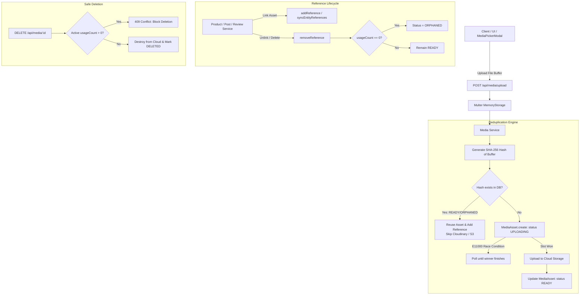

# Media Manager & Asset Registry — Implementation Plan

This document outlines the complete architectural blueprint and step-by-step implementation guide to replicate the **Media Manager & Asset Registry** in any project.

---

## 1. Architecture & Design Principles

The Media Manager is designed around **Content-Addressable Storage (CAS)** with **Embedded Reference Tracking**, **Multi-Tenancy**, and an **Interactive UI**.



### Core Features
1. **SHA-256 Content Deduplication**: Binary buffer hashing ensures identical files are stored only once. Subsequent uploads reuse the existing cloud asset.
2. **Race-Condition Safety**: A unique index on `contentHash` prevents double-upload race conditions during concurrent uploads.
3. **Embedded Reference Tracking & Safe GC**: Assets track every entity (Products, Blogs, Users, Reviews) using them. Assets with active references **cannot be deleted**.
4. **Auto-Orphan Lifecycle**: When unlinked, `usageCount` drops to `0` and status moves to `ORPHANED`, allowing for scheduled cleanup or instant revival if uploaded again.
5. **Albums, Taxonomy & Favorites**: Category/folder organization with dynamic aggregation counters and bulk operations.
6. **Multi-Tenancy**: Global library access for Admins; scoped library access for Vendors or individual Users (`createdBy`).
7. **Embeddable Modal (`MediaPickerModal`)**: Single/multi-selection modal with instant in-modal upload capabilities.

---

## 2. Prerequisites & Dependencies

### Backend (Node.js / Express / Mongoose)
```bash
npm install mongoose multer cloudinary crypto
```
*(If using AWS S3 instead of Cloudinary, substitute `@aws-sdk/client-s3` and `@aws-sdk/s3-request-presigner`).*

### Frontend (React / TailwindCSS)
```bash
npm install lucide-react
```

### Environment Variables (.env)
```env
PORT=5000
MONGODB_URI=mongodb://localhost:27017/my_project

# Storage Provider (e.g. Cloudinary)
CLOUDINARY_CLOUD_NAME=your_cloud_name
CLOUDINARY_API_KEY=your_api_key
CLOUDINARY_API_SECRET=your_api_secret

# Optional Configuration
MEDIA_ORPHAN_GRACE_DAYS=7
MAX_FILE_SIZE_BYTES=10485760 # 10MB
```

---

## 3. Database Schemas (Mongoose)

### 3.1 `MediaAsset.js`
Path: `backend/src/models/MediaAsset.js`

```javascript
const { Schema, model } = require("mongoose");

const STATUSES = ["UPLOADING", "READY", "ORPHANED", "DELETING", "DELETED", "FAILED"];
const RESOURCE_TYPES = ["image", "video", "raw"];
const VISIBILITIES = ["public", "private", "restricted"];

const ReferenceSchema = new Schema(
  {
    entityType: { type: String, required: true }, // e.g., "Product", "User", "BlogPost"
    entityId:   { type: String, required: true }, // MongoDB ObjectId string
    field:      { type: String },                 // e.g., "thumbnail", "gallery"
    createdAt:  { type: Date, default: Date.now },
  },
  { _id: false }
);

const MediaAssetSchema = new Schema(
  {
    // Deduplication Key
    contentHash:        { type: String, required: true, unique: true, index: true },
    hashAlgorithm:      { type: String, default: "sha256" },

    // Cloud Storage Identifiers
    cloudinaryPublicId: { type: String, index: true, sparse: true },
    secureUrl:          { type: String },

    // Metadata
    resourceType:       { type: String, enum: RESOURCE_TYPES, default: "image" },
    format:             { type: String },
    mimeType:           { type: String },
    fileSize:           { type: Number },
    width:              { type: Number },
    height:             { type: Number },
    folder:             { type: String, index: true },
    originalFilename:   { type: String },

    // Albums & Favorites
    albums:             [{ type: Schema.Types.ObjectId, ref: "MediaAlbum" }],
    isFavorite:         { type: Boolean, default: false, index: true },

    // Lifecycle
    status:             { type: String, enum: STATUSES, default: "UPLOADING", index: true },
    visibility:         { type: String, enum: VISIBILITIES, default: "public" },

    // Reference Tracking & Safe GC
    references:         { type: [ReferenceSchema], default: [] },
    usageCount:         { type: Number, default: 0 },

    orphanedAt:         { type: Date },
    deletedAt:          { type: Date },

    // Tenant Scoping / Audit
    createdBy:          { type: String, index: true },
    metadata:           { type: Schema.Types.Mixed, default: {} },
  },
  { timestamps: true }
);

// Indexes
MediaAssetSchema.index({ status: 1, orphanedAt: 1 });
MediaAssetSchema.index({ "references.entityType": 1, "references.entityId": 1 });

module.exports = { MediaAsset: model("MediaAsset", MediaAssetSchema) };
```

---

### 3.2 `MediaAlbum.js`
Path: `backend/src/models/MediaAlbum.js`

```javascript
const { Schema, model } = require("mongoose");

const MediaAlbumSchema = new Schema(
  {
    name:        { type: String, required: true, trim: true, maxlength: 100 },
    description: { type: String, trim: true, maxlength: 500 },
    coverImage:  { type: Schema.Types.ObjectId, ref: "MediaAsset" },
    createdBy:   { type: String, required: true, index: true },
  },
  { timestamps: true }
);

MediaAlbumSchema.index({ name: "text", description: "text" });

module.exports = { MediaAlbum: model("MediaAlbum", MediaAlbumSchema) };
```

---

## 4. Storage & Middleware Setup

### 4.1 Cloud Storage Config
Path: `backend/src/config/cloudinary.js`

```javascript
const cloudinary = require("cloudinary").v2;

function configureCloudinary() {
  const { CLOUDINARY_CLOUD_NAME, CLOUDINARY_API_KEY, CLOUDINARY_API_SECRET } = process.env;
  if (!CLOUDINARY_CLOUD_NAME || !CLOUDINARY_API_KEY || !CLOUDINARY_API_SECRET) {
    return { enabled: false, cloudinary: null };
  }
  cloudinary.config({
    cloud_name: CLOUDINARY_CLOUD_NAME,
    api_key: CLOUDINARY_API_KEY,
    api_secret: CLOUDINARY_API_SECRET,
    secure: true,
  });
  return { enabled: true, cloudinary };
}

module.exports = { configureCloudinary };
```

---

### 4.2 Multer Memory Storage
Path: `backend/src/middleware/upload.js`

```javascript
const multer = require("multer");

const storage = multer.memoryStorage();
const ALLOWED_MIME = new Set([
  "image/jpeg",
  "image/png",
  "image/webp",
  "video/mp4",
  "video/webm",
  "application/pdf"
]);

const upload = multer({
  storage,
  limits: { fileSize: 50 * 1024 * 1024 }, // 50MB
  fileFilter: (req, file, cb) => {
    if (!ALLOWED_MIME.has(file.mimetype)) {
      return cb(new Error("UNSUPPORTED_FILE_TYPE"));
    }
    cb(null, true);
  },
});

module.exports = { upload };
```

---

## 5. Core Services

### 5.1 `media.service.js`
Path: `backend/src/services/media.service.js`

```javascript
const crypto = require("crypto");
const { MediaAsset } = require("../models/MediaAsset");
const { MediaAlbum } = require("../models/MediaAlbum");
const { configureCloudinary } = require("../config/cloudinary");

function calculateContentHash(buffer) {
  if (!Buffer.isBuffer(buffer)) throw new TypeError("Buffer required for hashing");
  return crypto.createHash("sha256").update(buffer).digest("hex");
}

async function uploadBufferToCloudinary(file, folder) {
  const { enabled, cloudinary } = configureCloudinary();
  if (!enabled) throw new Error("Cloudinary not configured");

  const resourceType = file.mimetype === "application/pdf"
    ? "raw"
    : file.mimetype.startsWith("video/") ? "video" : "image";

  return new Promise((resolve, reject) => {
    const stream = cloudinary.uploader.upload_stream(
      { folder, resource_type: resourceType },
      (err, result) => (err ? reject(err) : resolve(result))
    );
    stream.end(file.buffer);
  });
}

async function pollForReady(hash, timeoutMs = 5000) {
  const start = Date.now();
  while (Date.now() - start < timeoutMs) {
    await new Promise((r) => setTimeout(r, 300));
    const asset = await MediaAsset.findOne({ contentHash: hash });
    if (asset?.status === "READY") return asset;
    if (asset?.status === "FAILED") return null;
  }
  return null;
}

function assetToResult(asset) {
  const doc = asset.toObject ? asset.toObject() : asset;
  return { ...doc, url: doc.secureUrl, publicId: doc.cloudinaryPublicId };
}

// ── Main Deduplicated Upload Entry Point ───────────────────────────────────────
async function uploadIfNotExists(file, context = {}) {
  const { folder = "general", entityType, entityId, field, createdBy, visibility = "public" } = context;
  const hash = calculateContentHash(file.buffer);

  // 1. Check if hash exists in READY or ORPHANED state
  const existing = await MediaAsset.findOne({
    contentHash: hash,
    status: { $in: ["READY", "ORPHANED"] },
  });

  if (existing) {
    if (existing.status === "ORPHANED") {
      existing.status = "READY";
      existing.orphanedAt = undefined;
      await existing.save();
    }
    if (entityType && entityId) {
      await addReference(existing._id, { entityType, entityId, field });
    }
    const result = assetToResult(existing);
    result.wasDeduplicated = true;
    return result;
  }

  // 2. Claim upload slot (Race safe via unique index)
  let asset;
  try {
    asset = await MediaAsset.create({
      contentHash: hash,
      status: "UPLOADING",
      folder,
      mimeType: file.mimetype,
      fileSize: file.size,
      originalFilename: file.originalname,
      visibility,
      createdBy: createdBy || "system",
    });
  } catch (err) {
    if (err.code === 11000) {
      // Race condition: wait for winner
      const winner = await pollForReady(hash);
      if (winner) {
        if (entityType && entityId) await addReference(winner._id, { entityType, entityId, field });
        const res = assetToResult(winner);
        res.wasDeduplicated = true;
        return res;
      }
      asset = await MediaAsset.findOne({ contentHash: hash });
      if (!asset) throw err;
      asset.status = "UPLOADING";
      await asset.save();
    } else {
      throw err;
    }
  }

  // 3. Upload to Cloudinary
  try {
    const result = await uploadBufferToCloudinary(file, folder);
    asset.cloudinaryPublicId = result.public_id;
    asset.secureUrl          = result.secure_url;
    asset.resourceType       = result.resource_type;
    asset.format             = result.format;
    asset.width              = result.width;
    asset.height             = result.height;
    asset.fileSize           = result.bytes || file.size;
    asset.status             = "READY";
    await asset.save();
  } catch (err) {
    asset.status = "FAILED";
    await asset.save().catch(() => {});
    throw err;
  }

  if (entityType && entityId) {
    await addReference(asset._id, { entityType, entityId, field });
  }

  return assetToResult(asset);
}

// ── Reference Tracking ────────────────────────────────────────────────────────
async function addReference(mediaId, { entityType, entityId, field }) {
  if (!entityType || !entityId) return;
  const existing = await MediaAsset.findOne({
    _id: mediaId,
    "references.entityType": entityType,
    "references.entityId": String(entityId),
    "references.field": field || { $exists: true },
  });
  if (existing) return;

  await MediaAsset.findByIdAndUpdate(mediaId, {
    $push: { references: { entityType, entityId: String(entityId), field } },
    $inc:  { usageCount: 1 },
    $set:  { status: "READY" },
  });
}

async function removeReference(mediaId, entityType, entityId) {
  const asset = await MediaAsset.findById(mediaId);
  if (!asset) return;

  const initialCount = asset.references.length;
  asset.references = asset.references.filter(
    (r) => !(r.entityType === entityType && r.entityId === String(entityId))
  );
  const diff = initialCount - asset.references.length;
  if (diff > 0) asset.usageCount = Math.max(0, asset.usageCount - diff);

  if (asset.usageCount === 0 && asset.references.length === 0 && asset.status === "READY") {
    asset.status = "ORPHANED";
    asset.orphanedAt = new Date();
  }
  await asset.save();
}

async function reconcileUsage(mediaId) {
  const asset = await MediaAsset.findById(mediaId);
  if (!asset) return null;
  const count = (asset.references || []).length;
  asset.usageCount = count;
  if (count === 0 && asset.status === "READY") {
    asset.status = "ORPHANED";
    asset.orphanedAt = new Date();
  } else if (count > 0 && asset.status === "ORPHANED") {
    asset.status = "READY";
    asset.orphanedAt = undefined;
  }
  await asset.save();
  return asset;
}

// ── Safe Deletion ─────────────────────────────────────────────────────────────
async function safeDelete(mediaId, createdBy = null) {
  const asset = await MediaAsset.findById(mediaId);
  if (!asset) return { success: false, message: "Asset not found" };
  if (createdBy && asset.createdBy && String(asset.createdBy) !== String(createdBy)) {
    return { success: false, message: "Unauthorized" };
  }
  if (asset.status === "DELETED") return { success: true, message: "Already deleted" };

  if ((asset.references || []).length > 0) {
    return {
      success: false,
      message: `Cannot delete: in use by ${asset.references.length} resource(s)`,
      references: asset.references,
    };
  }

  asset.status = "DELETING";
  await asset.save();

  if (asset.cloudinaryPublicId) {
    const { enabled, cloudinary } = configureCloudinary();
    if (enabled) {
      await cloudinary.uploader.destroy(asset.cloudinaryPublicId, {
        resource_type: asset.resourceType || "image",
      });
    }
  }

  asset.status = "DELETED";
  asset.deletedAt = new Date();
  await asset.save();

  await MediaAlbum.updateMany({ coverImage: mediaId }, { $unset: { coverImage: "" } });
  return { success: true, message: "Asset deleted" };
}

// ── Query & Bulk Operations ───────────────────────────────────────────────────
async function listAssets({ page = 1, limit = 24, status, format, resourceType, search, albumId, isFavorite, createdBy } = {}) {
  const filter = {};
  if (createdBy) filter.createdBy = String(createdBy);
  if (status) filter.status = status;
  else filter.status = { $ne: "DELETED" };

  if (format) filter.format = format;
  if (resourceType && resourceType !== "all") filter.resourceType = resourceType;
  if (isFavorite === "true" || isFavorite === true) filter.isFavorite = true;
  if (albumId) filter.albums = albumId;

  if (search) {
    const re = new RegExp(String(search).replace(/[.*+?^${}()|[\]\\]/g, "\\$&"), "i");
    filter.$or = [{ originalFilename: re }, { cloudinaryPublicId: re }, { contentHash: re }];
  }

  const skip = (Math.max(page, 1) - 1) * Math.min(limit, 100);
  const [assets, total] = await Promise.all([
    MediaAsset.find(filter).sort({ createdAt: -1 }).skip(skip).limit(limit).lean(),
    MediaAsset.countDocuments(filter),
  ]);

  return { assets, total, page, pages: Math.ceil(total / limit) };
}

async function toggleFavorite(mediaId, createdBy = null) {
  const asset = await MediaAsset.findById(mediaId);
  if (!asset) return null;
  if (createdBy && asset.createdBy && String(asset.createdBy) !== String(createdBy)) return null;
  asset.isFavorite = !asset.isFavorite;
  await asset.save();
  return asset;
}

async function bulkAction(action, assetIds, { targetAlbumId, createdBy } = {}) {
  const filter = { _id: { $in: assetIds } };
  if (createdBy) filter.createdBy = String(createdBy);

  if (action === "addToAlbum") {
    const res = await MediaAsset.updateMany(filter, { $addToSet: { albums: targetAlbumId } });
    return { modifiedCount: res.modifiedCount };
  }
  if (action === "removeFromAlbum") {
    const res = await MediaAsset.updateMany(filter, { $pull: { albums: targetAlbumId } });
    return { modifiedCount: res.modifiedCount };
  }
  if (action === "moveToAlbum") {
    const res = await MediaAsset.updateMany(filter, { $set: { albums: [targetAlbumId] } });
    return { modifiedCount: res.modifiedCount };
  }
  if (action === "delete") {
    let deletedCount = 0;
    let failedCount = 0;
    for (const id of assetIds) {
      const res = await safeDelete(id, createdBy);
      if (res.success) deletedCount++;
      else failedCount++;
    }
    return { deletedCount, failedCount };
  }
  throw new Error("Invalid bulk action");
}

async function getMetrics(createdBy = null) {
  const match = createdBy ? { createdBy: String(createdBy) } : {};
  const [statusCounts, totalCloudinary] = await Promise.all([
    MediaAsset.aggregate([
      ...(createdBy ? [{ $match: { createdBy: String(createdBy) } }] : []),
      { $group: { _id: "$status", count: { $sum: 1 } } }
    ]),
    MediaAsset.countDocuments({ ...match, cloudinaryPublicId: { $ne: null }, status: { $ne: "DELETED" } }),
  ]);

  const byStatus = Object.fromEntries(statusCounts.map((s) => [s._id, s.count]));
  return {
    totalAssets: Object.values(byStatus).reduce((a, b) => a + b, 0),
    readyAssets: byStatus.READY || 0,
    orphanedAssets: byStatus.ORPHANED || 0,
    failedAssets: byStatus.FAILED || 0,
    deletedAssets: byStatus.DELETED || 0,
    totalCloudinaryAssets: totalCloudinary,
  };
}

module.exports = {
  uploadIfNotExists,
  addReference,
  removeReference,
  reconcileUsage,
  safeDelete,
  listAssets,
  toggleFavorite,
  bulkAction,
  getMetrics,
  calculateContentHash,
};
```

---

### 5.2 `album.service.js`
Path: `backend/src/services/album.service.js`

```javascript
const { MediaAlbum } = require("../models/MediaAlbum");
const { MediaAsset } = require("../models/MediaAsset");

async function listAlbums(createdBy = null) {
  return await MediaAlbum.aggregate([
    ...(createdBy ? [{ $match: { createdBy: String(createdBy) } }] : []),
    { $sort: { createdAt: -1 } },
    {
      $lookup: {
        from: "mediaassets",
        let: { albumId: "$_id" },
        pipeline: [
          {
            $match: {
              $expr: {
                $and: [
                  { $in: ["$$albumId", { $ifNull: ["$albums", []] }] },
                  { $ne: ["$status", "DELETED"] },
                  ...(createdBy ? [{ $eq: ["$createdBy", String(createdBy)] }] : []),
                ],
              },
            },
          },
          { $count: "count" },
        ],
        as: "stats",
      },
    },
    {
      $addFields: {
        assetCount: { $ifNull: [{ $arrayElemAt: ["$stats.count", 0] }, 0] },
      },
    },
    { $project: { stats: 0 } },
  ]);
}

async function createAlbum(data, createdBy) {
  return await MediaAlbum.create({
    name: data.name,
    description: data.description,
    createdBy: String(createdBy),
  });
}

async function deleteAlbum(id, createdBy = null) {
  const filter = { _id: id };
  if (createdBy) filter.createdBy = String(createdBy);
  const album = await MediaAlbum.findOneAndDelete(filter);
  if (!album) throw new Error("Album not found");

  await MediaAsset.updateMany({ albums: id }, { $pull: { albums: id } });
  return album;
}

module.exports = { listAlbums, createAlbum, deleteAlbum };
```

---

## 6. Controllers & Routes

### 6.1 `media.controller.js`
Path: `backend/src/controllers/media.controller.js`

```javascript
const mediaService = require("../services/media.service");

// List assets with pagination and filters
async function listAssets(req, res, next) {
  try {
    const isTenant = req.user?.role !== "admin";
    const createdBy = isTenant ? req.user.id : req.query.createdBy;
    const result = await mediaService.listAssets({ ...req.query, createdBy });
    res.json({ success: true, ...result });
  } catch (err) { next(err); }
}

// Upload assets with deduplication
async function uploadAsset(req, res, next) {
  try {
    const files = req.files || (req.file ? [req.file] : []);
    if (!files.length) return res.status(400).json({ success: false, message: "No files uploaded" });

    const createdBy = req.user?.id || "system";
    const folder = req.body.folder || (req.user?.role !== "admin" ? `users/${createdBy}` : "general");

    const assets = await Promise.all(
      files.map((file) => mediaService.uploadIfNotExists(file, { folder, createdBy }))
    );

    const dupes = assets.filter((a) => a.wasDeduplicated).length;
    res.status(201).json({
      success: true,
      assets,
      message: `Uploaded ${assets.length} file(s)${dupes ? ` (${dupes} deduplicated)` : ""}`,
    });
  } catch (err) { next(err); }
}

// Safe delete asset
async function deleteAsset(req, res, next) {
  try {
    const isTenant = req.user?.role !== "admin";
    const createdBy = isTenant ? req.user.id : undefined;
    const result = await mediaService.safeDelete(req.params.id, createdBy);

    if (!result.success) {
      return res.status(result.references ? 409 : 400).json({ success: false, ...result });
    }
    res.json({ success: true, ...result });
  } catch (err) { next(err); }
}

// Toggle Favorite
async function toggleFavorite(req, res, next) {
  try {
    const isTenant = req.user?.role !== "admin";
    const createdBy = isTenant ? req.user.id : undefined;
    const asset = await mediaService.toggleFavorite(req.params.id, createdBy);
    if (!asset) return res.status(404).json({ success: false, message: "Asset not found" });
    res.json({ success: true, asset });
  } catch (err) { next(err); }
}

// Bulk Action
async function bulkAction(req, res, next) {
  try {
    const { action, assetIds, targetAlbumId } = req.body;
    const isTenant = req.user?.role !== "admin";
    const createdBy = isTenant ? req.user.id : undefined;
    const result = await mediaService.bulkAction(action, assetIds, { targetAlbumId, createdBy });
    res.json({ success: true, result });
  } catch (err) { next(err); }
}

// Metrics
async function getMetrics(req, res, next) {
  try {
    const isTenant = req.user?.role !== "admin";
    const createdBy = isTenant ? req.user.id : undefined;
    const metrics = await mediaService.getMetrics(createdBy);
    res.json({ success: true, metrics });
  } catch (err) { next(err); }
}

module.exports = { listAssets, uploadAsset, deleteAsset, toggleFavorite, bulkAction, getMetrics };
```

---

### 6.2 Route Registration
Path: `backend/src/routes/media.routes.js`

```javascript
const { Router } = require("express");
const { upload } = require("../middleware/upload");
const {
  listAssets,
  uploadAsset,
  deleteAsset,
  toggleFavorite,
  bulkAction,
  getMetrics,
} = require("../controllers/media.controller");

const router = Router();

router.get("/metrics", getMetrics);
router.get("/", listAssets);
router.post("/upload", upload.array("files", 20), uploadAsset);
router.put("/:id/favorite", toggleFavorite);
router.post("/bulk-action", bulkAction);
router.delete("/:id", deleteAsset);

module.exports = router;
```

---

## 7. Connecting Media to Other Models

Whenever saving or updating other documents (such as Products, Blog Posts, or Profiles), link them to the Media Asset registry:

```javascript
// Example: Product Service linking
async function syncProductMedia(productId, mediaList = []) {
  const mediaIds = mediaList.map((m) => m._id).filter(Boolean);

  // 1. Link references to newly added assets
  for (const id of mediaIds) {
    await mediaService.addReference(id, {
      entityType: "Product",
      entityId: String(productId),
      field: "images",
    });
  }

  // 2. Remove references from unlinked assets
  const existingReferenced = await MediaAsset.find({
    "references.entityType": "Product",
    "references.entityId": String(productId),
    _id: { $nin: mediaIds },
  });

  for (const asset of existingReferenced) {
    await mediaService.removeReference(asset._id, "Product", String(productId));
  }
}

// Example: When deleting a Product completely
async function onProductDeleted(productId) {
  const referenced = await MediaAsset.find({
    "references.entityType": "Product",
    "references.entityId": String(productId),
  });
  for (const asset of referenced) {
    await mediaService.removeReference(asset._id, "Product", String(productId));
  }
}
```

---

## 8. Frontend Components

### 8.1 Reusable `MediaPickerModal.jsx`
Path: `frontend/src/components/MediaPickerModal.jsx`

```jsx
import { useState, useEffect, useCallback } from "react";
import { Search, UploadCloud, X, Check } from "lucide-react";

export function MediaPickerModal({
  isOpen,
  onClose,
  onSelect,
  maxSelect = 1,
  apiEndpoint = "/api/media"
}) {
  const [assets, setAssets] = useState([]);
  const [selectedIds, setSelectedIds] = useState(new Set());
  const [loading, setLoading] = useState(false);
  const [uploading, setUploading] = useState(false);
  const [search, setSearch] = useState("");

  const fetchAssets = useCallback(async () => {
    setLoading(true);
    try {
      const res = await fetch(`${apiEndpoint}?search=${encodeURIComponent(search)}&limit=30`);
      const data = await res.json();
      setAssets(data.assets || []);
    } finally {
      setLoading(false);
    }
  }, [apiEndpoint, search]);

  useEffect(() => {
    if (isOpen) {
      setSelectedIds(new Set());
      fetchAssets();
    }
  }, [isOpen, fetchAssets]);

  const toggleSelect = (asset) => {
    const next = new Set(selectedIds);
    if (next.has(asset._id)) {
      next.delete(asset._id);
    } else {
      if (maxSelect === 1) next.clear();
      else if (next.size >= maxSelect) return;
      next.add(asset._id);
    }
    setSelectedIds(next);
  };

  const handleFileUpload = async (e) => {
    const files = e.target.files;
    if (!files?.length) return;
    setUploading(true);

    const formData = new FormData();
    for (let i = 0; i < files.length; i++) formData.append("files", files[i]);

    try {
      await fetch(`${apiEndpoint}/upload`, { method: "POST", body: formData });
      fetchAssets();
    } finally {
      setUploading(false);
      e.target.value = null;
    }
  };

  const handleConfirm = () => {
    const selected = assets.filter((a) => selectedIds.has(a._id));
    onSelect(selected);
    onClose();
  };

  if (!isOpen) return null;

  return (
    <div className="fixed inset-0 z-50 flex items-center justify-center p-4 bg-slate-900/50 backdrop-blur-xs">
      <div className="bg-white rounded-2xl shadow-2xl w-full max-w-4xl h-[80vh] flex flex-col overflow-hidden">
        {/* Header */}
        <div className="flex items-center justify-between px-6 py-4 border-b border-slate-100 bg-slate-50">
          <div className="flex items-center gap-4">
            <h2 className="text-lg font-bold text-slate-800">Media Library</h2>
            <label className="cursor-pointer inline-flex items-center gap-1.5 bg-violet-600 text-white px-3 py-1.5 rounded-lg text-xs font-semibold hover:bg-violet-700 transition">
              <UploadCloud className="w-4 h-4" />
              <span>{uploading ? "Uploading..." : "Upload New"}</span>
              <input type="file" multiple accept="image/*" className="hidden" onChange={handleFileUpload} disabled={uploading} />
            </label>
          </div>
          <button onClick={onClose} className="p-1 rounded-lg text-slate-400 hover:text-slate-600">
            <X className="w-5 h-5" />
          </button>
        </div>

        {/* Search */}
        <div className="p-4 border-b border-slate-100">
          <div className="relative">
            <Search className="w-4 h-4 absolute left-3 top-3 text-slate-400" />
            <input
              type="text"
              placeholder="Search filename, format, hash..."
              value={search}
              onChange={(e) => setSearch(e.target.value)}
              className="w-full pl-9 pr-4 py-2 border rounded-xl text-sm focus:outline-none focus:ring-2 focus:ring-violet-500/20"
            />
          </div>
        </div>

        {/* Grid */}
        <div className="flex-1 overflow-y-auto p-4 grid grid-cols-3 sm:grid-cols-4 md:grid-cols-6 gap-3">
          {assets.map((asset) => {
            const isSelected = selectedIds.has(asset._id);
            return (
              <div
                key={asset._id}
                onClick={() => toggleSelect(asset)}
                className={`relative aspect-square rounded-xl overflow-hidden cursor-pointer border-2 transition-all ${
                  isSelected ? "border-violet-600 ring-2 ring-violet-300" : "border-slate-100 hover:border-violet-300"
                }`}
              >
                
                {isSelected && (
                  <div className="absolute top-2 right-2 bg-violet-600 text-white rounded-full p-1 shadow-sm">
                    <Check className="w-3.5 h-3.5 stroke-[3]" />
                  </div>
                )}
              </div>
            );
          })}
        </div>

        {/* Footer */}
        <div className="p-4 border-t border-slate-100 flex items-center justify-between bg-slate-50">
          <span className="text-xs font-semibold text-slate-500">{selectedIds.size} / {maxSelect} selected</span>
          <div className="flex gap-2">
            <button onClick={onClose} className="px-4 py-2 text-xs font-bold text-slate-600 hover:bg-slate-200 rounded-xl">Cancel</button>
            <button
              onClick={handleConfirm}
              disabled={selectedIds.size === 0}
              className="px-5 py-2 text-xs font-bold bg-violet-600 text-white rounded-xl hover:bg-violet-700 disabled:opacity-50"
            >
              Insert Selected
            </button>
          </div>
        </div>
      </div>
    </div>
  );
}
```

---

## 9. Verification & Testing Checklist

| Step | Action | Expected Output |
|---|---|---|
| **1. Deduplication** | Upload `photo.png` twice via API/UI | Only **1 record** created in MongoDB. Second call returns existing asset with `wasDeduplicated: true`. |
| **2. Concurrency** | Send 2 simultaneous requests with the same image buffer | Unique index catches winner/loser, one uploads, other polls and returns winning record. |
| **3. References** | Attach an asset to a Product | Asset document shows reference in `references[]` and `usageCount = 1`. |
| **4. Safe Deletion Block** | Call `DELETE /api/media/:id` on referenced asset | Status `409 Conflict` returned with reference details. Asset remains intact on Cloud storage. |
| **5. Orphan Lifecycle** | Delete the Product or remove reference | `usageCount` drops to `0`, status becomes `ORPHANED` with `orphanedAt` timestamp. |
| **6. Safe Deletion Execution** | Call `DELETE /api/media/:id` on orphaned asset | Cloud storage `destroy()` called, status marked `DELETED`, removed from albums. |
